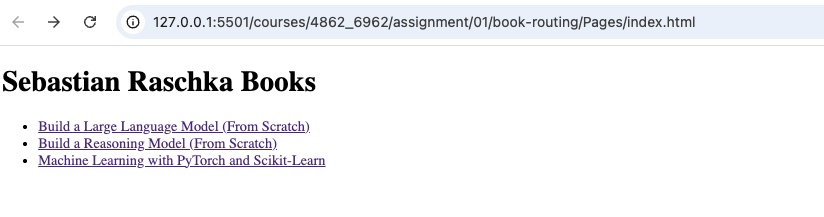
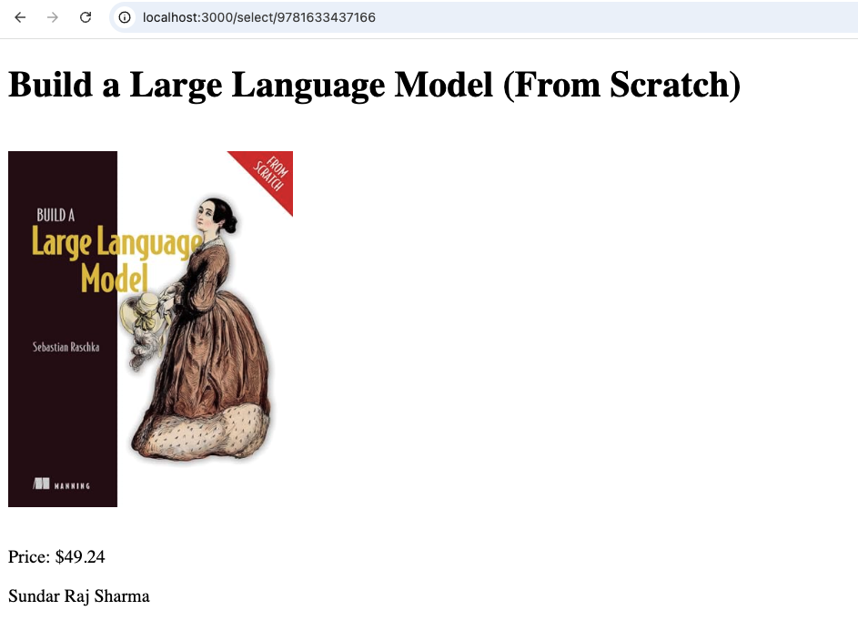
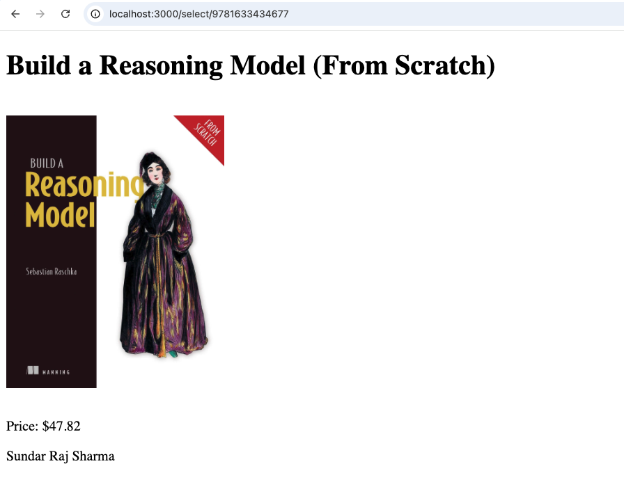
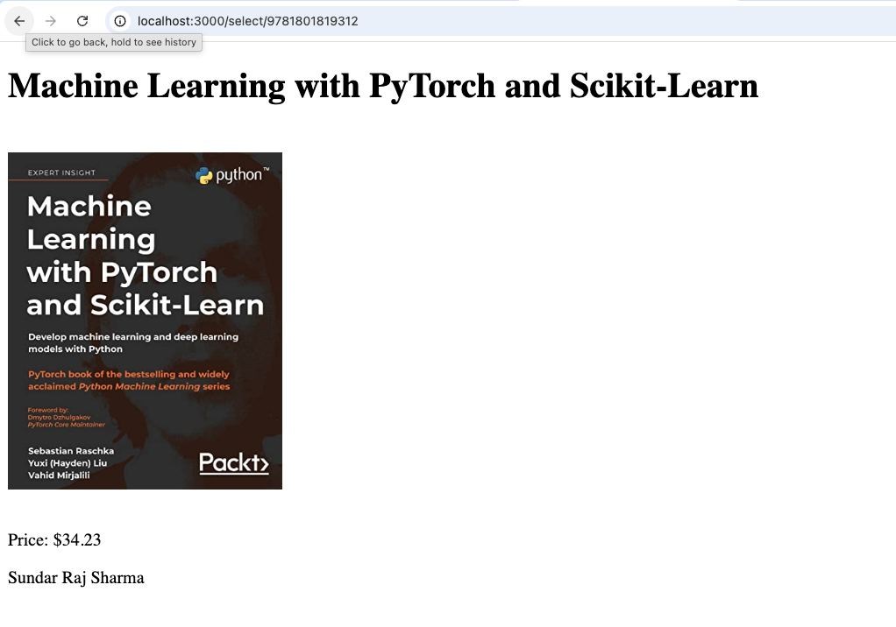

# Assignment 01 Output

## 1. Current Project Directory

First, the `pwd` command is used to show the current working directory.

    pwd

Output:

    /Users/ssharma33/Desktop/ta-docs-fall-2026/courses/4862_6962/assignment/01/book-routing

This confirms that the application is being run from the `book-routing` project directory.

## 2. Project Files

The `book-routing` directory contains the Node.js application and the `Pages` directory.

    ls

Output:

    app.js
    node_modules
    package-lock.json
    package.json
    Pages

The `Pages` directory contains the HTML pages and the images directory.

    cd Pages
    ls

Output:

    9781633434677.html
    9781633437166.html
    9781801819312.html
    images
    index.html

The `Pages/images` directory contains the three book cover images.

    cd images
    ls

Output:

    9781633434677.png
    9781633437166.png
    9781801819312.png

Therefore, the current application contains one index page, three book detail pages, and three corresponding book cover images.

## 3. Run the Application

Return to the `book-routing` directory and run the Node.js application:

    node app.js

The server is now running on port `3000`:

    Server running at http://localhost:3000

## 4. Open the Application

Open the following URL in a browser:

`http://localhost:3000`

The Express server handles the `/` request and sends the `Pages/index.html` file.

## 5. Output

### Main Book Selection Page

The main page displays the three books and links to their corresponding product pages.

### Book Detail Pages

Each book link opens the corresponding detail page using the ISBN-based server route.

#### Build a Large Language Model (From Scratch)

#### Build a Reasoning Model (From Scratch)

#### Machine Learning with PyTorch and Scikit-Learn

## 6. Client and Server Routing

The `index.html` file is a static HTML client page located inside the `Pages` directory.

The following URL shows the `index.html` page being served by a local development server:

`http://127.0.0.1:5501/courses/4862_6962/assignment/01/book-routing/Pages/index.html`

Port `5501` is the local server being used to serve the client-side `index.html` file.

From the page, the book links call the Express server running on port `3000`.

For example:

`http://localhost:3000/select/9781633437166`

The request is sent to the Express server. The dynamic route processes the ISBN and serves the corresponding HTML file from the `Pages` directory.

For example:

`/select/9781633437166`

serves:

`Pages/9781633437166.html`

## 7. Application Routes

The application uses the following Express routes:

- `/` - Displays the main book selection page.
- `/select/:variable` - Dynamically displays a book page based on its ISBN.
- `/images/:filename` - Serves the book cover images.

## 8. Error Handling

A nonexistent book page returns:

`File Not Found`

Other server-side errors return:

`Server Error`

## 9. Output Screenshots

The `snapshots` directory contains the screenshots of the application output:

    snapshots/
    ├── llm.png
    ├── main.png
    ├── ml.png
    └── reasoning.png

- `main.png` - Main book selection page.
- `llm.png` - Build a Large Language Model detail page.
- `reasoning.png` - Build a Reasoning Model detail page.
- `ml.png` - Machine Learning with PyTorch and Scikit-Learn detail page.

This `output.md` documents the project directory, files, application execution, client and server routing, application routes, error handling, and final output.